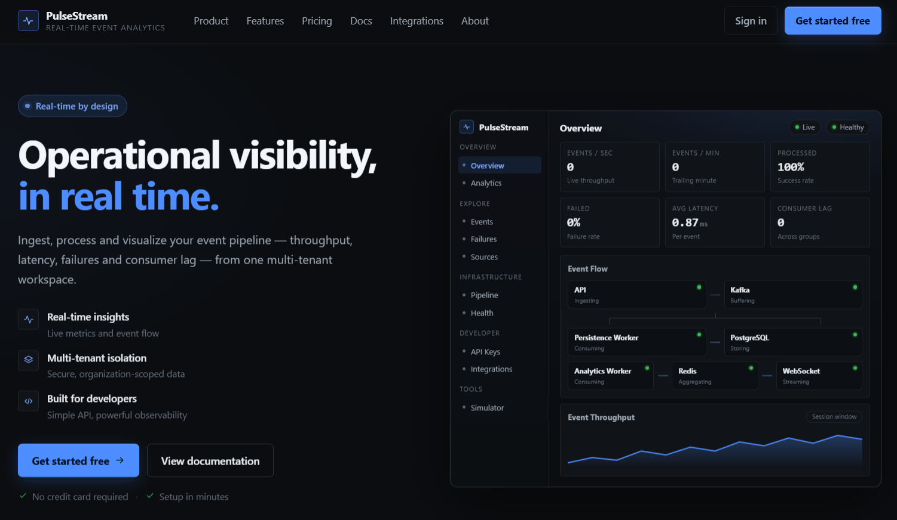
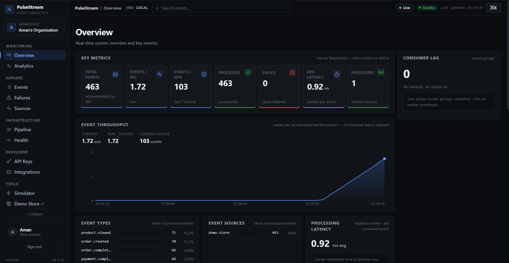
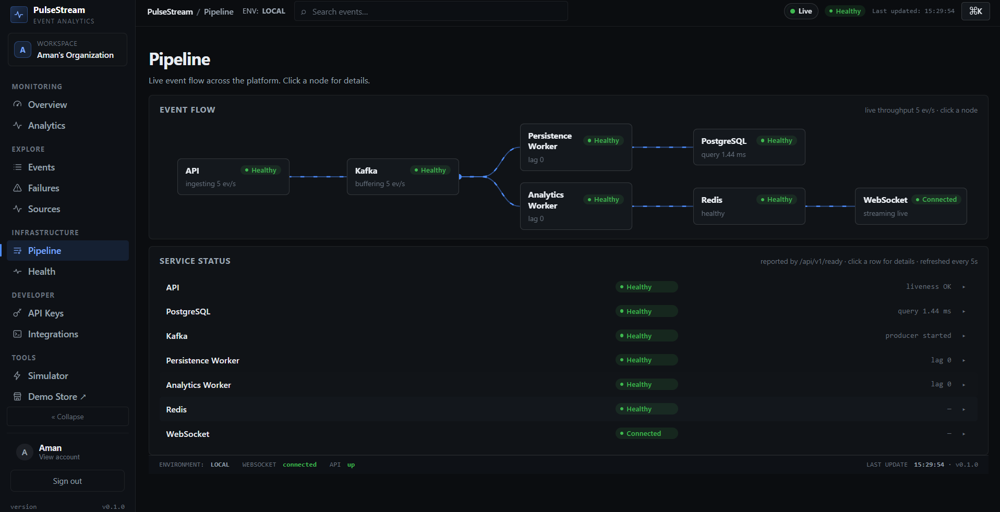
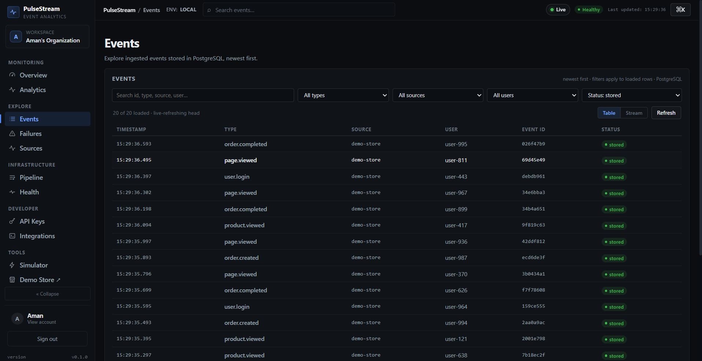
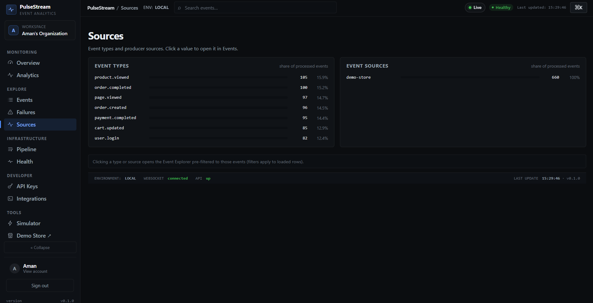
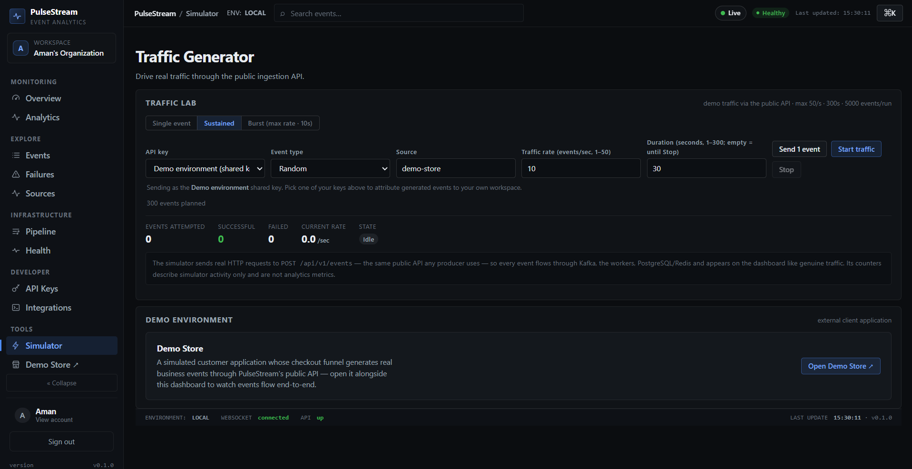
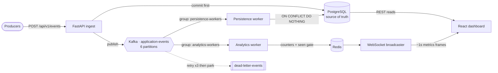

<div align="center">


<br/>


<br/><br/>


<br/>


<br/><br/>

<table>
<tr>
<td align="center" width="150"><a href="#-quick-start"><b>⚡ Quick start</b></a></td>
<td align="center" width="150"><a href="#-see-it-running"><b>👀 See it</b></a></td>
<td align="center" width="150"><a href="#-how-it-actually-works"><b>🧩 Pipeline</b></a></td>
<td align="center" width="150"><a href="#-api"><b>📡 API</b></a></td>
<td align="center" width="150"><a href="#-measured-not-claimed"><b>📈 Numbers</b></a></td>
<td align="center" width="150"><a href="#-documentation"><b>📖 Docs</b></a></td>
</tr>
</table>

<sub><b>PulseStream</b> ingests events over HTTP, streams them through Kafka into two independent worker lanes, and renders throughput, latency, failures and consumer lag in a live multi-tenant dashboard.</sub>


</div>

<div align="center">

## 👀 See it running

<sub>Real screenshots from a local run — the numbers are whatever the pipeline actually measured at that moment.</sub>

<br/>



<sub><b>Public landing page</b> — the product preview mirrors the real Overview, including the forked pipeline topology.</sub>

<br/><br/>

<table>
<tr>
<td width="50%"></td>
<td width="50%"></td>
</tr>
<tr>
<td align="center"><b>📊 Overview</b><br/><sub>KPI cards · live throughput chart · consumer lag</sub></td>
<td align="center"><b>🔀 Pipeline</b><br/><sub>Live topology · per-service health from <code>/ready</code></sub></td>
</tr>
<tr>
<td width="50%"></td>
<td width="50%"></td>
</tr>
<tr>
<td align="center"><b>🔎 Events</b><br/><sub>Live-refreshing head · filters · table/stream views</sub></td>
<td align="center"><b>🧬 Sources</b><br/><sub>Type &amp; producer distribution · click to drill in</sub></td>
</tr>
<tr>
<td colspan="2"></td>
</tr>
<tr>
<td colspan="2" align="center"><b>⚡ Traffic generator</b><br/><sub>Drives <b>real</b> HTTP traffic through <code>POST /api/v1/events</code> — single, sustained or burst — so the whole pipeline lights up end to end</sub></td>
</tr>
</table>


</div>

<div align="center">

## 🧩 How it actually works



<sub>⚠️ <b>The two consumer lanes never rejoin.</b> They are separate Kafka consumer groups on the same topic, with separate failure domains and separate offsets.</sub>

</div>

<br/>

<table>
<tr><th align="left" width="180">Stage</th><th align="left">What happens</th><th align="left" width="230">Guarantee</th></tr>
<tr><td><b>1 · Ingest</b></td><td><code>POST /api/v1/events</code> validates the payload, authenticates the API key, commits to PostgreSQL, <i>then</i> publishes to Kafka</td><td>Write is durable before it is streamed</td></tr>
<tr><td><b>2 · Stream</b></td><td><code>application-events</code>, 6 partitions, key <code>user_id → source → event_id</code>, <code>acks=all</code> + idempotent producer</td><td>At-least-once, per-user ordering</td></tr>
<tr><td><b>3a · Persist</b></td><td><code>persistence-workers</code> → <code>INSERT … ON CONFLICT DO NOTHING</code> on <code>event_id</code>, manual offset commit after success</td><td>Duplicate delivery is a no-op</td></tr>
<tr><td><b>3b · Aggregate</b></td><td><code>analytics-workers</code> → Redis counters (<code>total</code>, <code>by_type</code>, <code>by_source</code>, <code>per_minute</code>) behind a <code>seen:{event_id}</code> gate</td><td>Idempotent counters, per-tenant keys</td></tr>
<tr><td><b>4 · Broadcast</b></td><td><code>/api/v1/ws</code> pushes <code>{"type":"metrics","data":{…}}</code> ≈ every second; browsers never touch Kafka</td><td>REST polling fallback on disconnect</td></tr>
<tr><td><b>5 · Contain</b></td><td>Poison events retry 3× (100 ms → 400 ms → 1600 ms) then go to <code>dead-letter-events</code>; permanent errors skip the retry loop</td><td>No endless retry, no lost audit trail</td></tr>
</table>

<details>
<summary><b>🔬 Same topology as a Mermaid graph</b> (click to expand)</summary>



</details>

<div align="center">


## ✨ What's in the box

</div>

<table>
<tr>
<td width="33%" valign="top"><b>📥 Ingest that doesn't lie</b><br/><sub>Single + batch (≤ 1000, all-or-nothing). Duplicate <code>event_id</code> → <code>409</code>. Oversized body → <code>413</code>. One error envelope everywhere.</sub></td>
<td width="33%" valign="top"><b>🔀 Real streaming</b><br/><sub>Kafka 3.9 in KRaft mode, 6 partitions, idempotent producer, manual offset commits, bounded retry + dead-letter topic.</sub></td>
<td width="33%" valign="top"><b>⚡ Live dashboard</b><br/><sub>WebSocket metrics ≈1 s with exponential reconnect (1→2→4 s) and automatic REST polling fallback.</sub></td>
</tr>
<tr>
<td valign="top"><b>🏢 Multi-tenant by construction</b><br/><sub>Organizations + memberships; analytics keys namespaced per org (<code>org:{id}:analytics:*</code>) so one tenant can never read another's counters.</sub></td>
<td valign="top"><b>🔐 Session auth, done properly</b><br/><sub>Argon2id passwords, opaque session tokens stored as SHA-256 digests, CSRF-protected mutations, rate-limited login &amp; password reset.</sub></td>
<td valign="top"><b>🔑 Hashed API keys</b><br/><sub>Keys are shown once and stored as digests; constant-time compare; the presented key is never logged or echoed. Revocable per key.</sub></td>
</tr>
<tr>
<td valign="top"><b>📈 Operational surface</b><br/><sub>Prometheus <code>/metrics</code>, dependency-aware <code>/ready</code>, structured JSON logs, real <code>pulsestream_consumer_lag{group,partition}</code>.</sub></td>
<td valign="top"><b>🧪 Traffic generator + demo store</b><br/><sub>In-app simulator and a separate demo e-commerce client, both driving the <i>public</i> API like any third-party producer.</sub></td>
<td valign="top"><b>🐳 One command up</b><br/><sub>Compose brings up PostgreSQL, Kafka, Redis, API, both workers and the nginx-served dashboard. Multi-stage prod image, non-root.</sub></td>
</tr>
</table>

<div align="center">


## ⚡ Quick start

</div>

```bash
git clone https://github.com/amansinghyadav4/PulseStream.git && cd PulseStream
cp .env.example .env          # safe development defaults
docker compose up -d          # PostgreSQL 16 + Kafka 3.9 + Redis 7 + api + 2 workers + dashboard
```

<div align="center">

**Dashboard → [localhost:3000](http://localhost:3000)** · **API docs → [localhost:8001/docs](http://localhost:8001/docs)** · **Demo store → [localhost:3001](http://localhost:3001)**

<sub>Sign up in the dashboard, open <b>Tools → Simulator</b>, press <b>Start traffic</b>, and watch every page go live.</sub>

</div>

<details>
<summary><b>🛠️ Prefer running the API on the host?</b> (PowerShell)</summary>

```powershell
python -m venv .venv
.\.venv\Scripts\pip install -r requirements.txt -r requirements-dev.txt
docker compose up -d postgres kafka redis
.\.venv\Scripts\uvicorn app.main:app --reload --port 8000
```

> ℹ️ The compose stack mounts source but runs **without auto-reload** — after editing `app/` or `worker/`, run `docker compose restart api persistence-worker analytics-worker`.

</details>

<div align="center">


## 📡 API

</div>

<table>
<tr><th align="left">Method</th><th align="left">Endpoint</th><th align="left">Purpose</th></tr>
<tr><td><code>POST</code></td><td><code>/api/v1/events</code></td><td>Ingest one event → <code>201</code> (API key required)</td></tr>
<tr><td><code>POST</code></td><td><code>/api/v1/events/batch</code></td><td>Ingest ≤ 1000 events, all-or-nothing → <code>201</code></td></tr>
<tr><td><code>GET</code></td><td><code>/api/v1/events?limit=&amp;offset=</code></td><td>Recent events from PostgreSQL, newest first</td></tr>
<tr><td><code>GET</code></td><td><code>/api/v1/events/{id}</code></td><td>Fetch one event by UUID</td></tr>
<tr><td><code>GET</code></td><td><code>/api/v1/analytics</code></td><td>Live counters from Redis (in-memory fallback)</td></tr>
<tr><td><code>GET</code></td><td><code>/api/v1/failures</code></td><td>Terminal processing failures — the DLQ audit trail</td></tr>
<tr><td><code>WS</code></td><td><code>/api/v1/ws</code></td><td>Metrics frames ≈ every second</td></tr>
<tr><td><code>GET</code></td><td><code>/api/v1/health</code> · <code>/api/v1/ready</code></td><td>Liveness · dependency-aware readiness</td></tr>
<tr><td><code>GET</code></td><td><code>/metrics</code></td><td>Prometheus exposition, incl. real consumer lag</td></tr>
<tr><td><code>POST</code></td><td><code>/api/v1/auth/{signup,login,logout}</code></td><td>Session cookie auth (CSRF-protected mutations)</td></tr>
<tr><td><code>GET</code></td><td><code>/api/v1/auth/me</code></td><td>Current user + organization</td></tr>
<tr><td><code>POST</code></td><td><code>/api/v1/auth/{forgot,reset}-password</code></td><td>Rate-limited reset flow</td></tr>
<tr><td><code>GET</code> <code>POST</code></td><td><code>/api/v1/api-keys</code> · <code>/{id}/revoke</code></td><td>Issue, list and revoke ingestion keys</td></tr>
</table>

```bash
curl -X POST http://localhost:8001/api/v1/events \
  -H "Content-Type: application/json" \
  -H "X-API-Key: $PULSESTREAM_API_KEY" \
  -d '{"event_id":"11111111-1111-1111-1111-111111111111",
       "event_type":"order.created","source":"checkout",
       "user_id":"user-42","payload":{"total":42.5}}'
```

<details>
<summary><b>📋 Error contract</b> — one envelope, no surprises</summary>

```json
{ "error": { "code": "duplicate_event", "message": "…", "details": null } }
```

| Situation | Status | Code |
|---|---|---|
| Duplicate `event_id` | `409` | `duplicate_event` |
| Body over `MAX_BODY_BYTES` (1 MiB default) | `413` | `payload_too_large` |
| Missing / wrong API key | `401` | `missing_api_key` · `invalid_api_key` |
| Valid key, bad payload | `422` | `validation_error` |

Public by design (no auth): `/health`, `/ready`, `/metrics`, `/analytics`, `GET /events*`, WebSocket. Only **writes from external producers** cross the trust boundary.

</details>

<div align="center">


## 📈 Measured, not claimed

<sub>Numbers below come from a real benchmark ladder on <b>one developer machine</b>. They are recorded so the bottlenecks are visible — <b>not</b> as general performance claims. Methodology, environment and analysis: <a href="docs/load-testing.md"><code>docs/load-testing.md</code></a>.</sub>

</div>

<table>
<tr><th align="left" width="230">Path</th><th align="left" width="180">Observed</th><th align="left">Why it lands there</th></tr>
<tr><td><b>Batch ingest</b></td><td>≈ 4.8K events/s @ p95 1.5 s<br/>≈ 7K events/s saturated</td><td>One PG commit + one Kafka ack amortized across the whole batch</td></tr>
<tr><td><b>Single-event ingest</b></td><td>≈ 50 events/s</td><td>Per-request commit + broker ack dominates — the honest cost of durability-before-stream</td></tr>
<tr><td><b>Persistence worker drain</b></td><td>≈ 370 events/s idle</td><td>Per-event commits; bursts convert into backlog rather than loss</td></tr>
</table>

<div align="center">
<sub>🚫 No invented throughput, no fabricated uptime, no fake logos anywhere in this project — the dashboard renders <code>—</code> when a metric genuinely isn't available.</sub>


## 🧱 Tech stack

</div>

<table>
<tr><th align="left" width="150">Layer</th><th align="left">Choice</th><th align="left">Reason it's here</th></tr>
<tr><td><b>API</b></td><td>Python 3.12 · FastAPI · Pydantic v2</td><td>Async ingest with schema validation at the edge</td></tr>
<tr><td><b>Storage</b></td><td>PostgreSQL 16 · SQLAlchemy 2 async · asyncpg · Alembic</td><td>Source of truth + migrations</td></tr>
<tr><td><b>Streaming</b></td><td>Apache Kafka 3.9 (KRaft) · aiokafka</td><td>Decouple ingest from processing; replayable log</td></tr>
<tr><td><b>Speed layer</b></td><td>Redis 7 · redis-py asyncio · fakeredis in tests</td><td>Counters the dashboard can read in microseconds</td></tr>
<tr><td><b>Frontend</b></td><td>React 18 · JavaScript (ES Modules) · Vite · hash router</td><td>Zero runtime UI dependencies — only <code>react</code> + <code>react-dom</code></td></tr>
<tr><td><b>Ops</b></td><td>Docker Compose · nginx · Prometheus metrics · JSON logs</td><td>One-command topology, real readiness semantics</td></tr>
<tr><td><b>Tests</b></td><td>pytest · pytest-asyncio · httpx · vitest · Testing Library</td><td>Unit always runnable; integration skips without Docker</td></tr>
</table>

<div align="center">


## 🧪 Tests

</div>

```powershell
.\.venv\Scripts\pytest -m "not integration"   # backend unit — no Docker needed
.\.venv\Scripts\pytest                        # full backend suite — needs PostgreSQL up
cd frontend; npm run test                     # vitest (jsdom)
```

<sub>Integration tests skip cleanly when PostgreSQL is unreachable, so a fresh clone is always testable. The frontend suite covers routing guards, session auth, CSRF headers, API keys and the landing page.</sub>

<div align="center">


## 📖 Documentation

</div>

<table>
<tr>
<td valign="top" width="50%">

| Doc | Contents |
|---|---|
| [`docs/architecture.md`](docs/architecture.md) | As-built topology, components, event flow, guarantees |
| [`docs/kafka-topics.md`](docs/kafka-topics.md) | Partition &amp; key design, ordering trade-offs |
| [`docs/redis.md`](docs/redis.md) | Key schema, TTLs, idempotency gates |
| [`docs/dashboard.md`](docs/dashboard.md) | Metric traceability: source → calc → transport → pixel |

</td>
<td valign="top" width="50%">

| Doc | Contents |
|---|---|
| [`docs/reliability.md`](docs/reliability.md) | Health/readiness semantics, failure matrix |
| [`docs/load-testing.md`](docs/load-testing.md) | Benchmark methodology and bottleneck analysis |
| [`docs/event-simulator.md`](docs/event-simulator.md) | Built-in traffic generator and safe limits |
| [`docs/demo-store.md`](docs/demo-store.md) | Demo e-commerce client — a simulated customer |

</td>
</tr>
</table>

<sub>📓 <a href="PulseStream_LEARNING.md"><b>PulseStream_LEARNING.md</b></a> is the engineering log — every decision, trade-off, dead end and fix, in order. 🗺️ <a href="PulseStream_PROJECT_SPEC.md"><b>PulseStream_PROJECT_SPEC.md</b></a> is the authoritative spec. ☁️ <a href="infra/aws/README.md"><b>infra/aws/README.md</b></a> is the cloud runbook.</sub>

<div align="center">


## 🗺️ Build status

</div>

<table>
<tr><th align="left" width="90">Phase</th><th align="left" width="230">Scope</th><th align="left">State</th></tr>
<tr><td><b>1</b></td><td>Foundation — FastAPI + PostgreSQL ingest</td><td>✅ Done</td></tr>
<tr><td><b>2</b></td><td>Kafka producer, consumers, DLQ</td><td>✅ Done</td></tr>
<tr><td><b>3</b></td><td>Persistence worker &amp; idempotency</td><td>✅ Done</td></tr>
<tr><td><b>4</b></td><td>Redis analytics layer</td><td>✅ Done</td></tr>
<tr><td><b>5</b></td><td>Real-time dashboard (WebSocket + fallback)</td><td>✅ Done</td></tr>
<tr><td><b>6</b></td><td>Reliability — health, readiness, metrics, failure matrix</td><td>✅ Done</td></tr>
<tr><td><b>7</b></td><td>Performance — benchmark ladder, bottleneck analysis</td><td>✅ Done <sub>(measured, documented)</sub></td></tr>
<tr><td><b>8</b></td><td>Cloud — production images, prod compose topology, AWS runbook</td><td>🟡 Images &amp; runbook ready · AWS execution is operator-run</td></tr>
<tr><td><b>9</b></td><td>Documentation &amp; polish</td><td>🟡 In progress</td></tr>
</table>

<sub>Beyond the numbered phases: multi-tenant organizations, session authentication, hashed API keys, the traffic generator and the demo-store client are all built and covered by tests.</sub>

<details>
<summary><b>⚙️ Configuration</b> — every variable has a safe development default</summary>

<br/>

All settings load from the environment / `.env` via pydantic-settings — see [`.env.example`](.env.example). `DATABASE_URL` is mandatory in production, and the app **fails fast** if any endpoint is still on a development default when `APP_ENV=production`.

| Variable | Default | Purpose |
|---|---|---|
| `PULSESTREAM_API_KEYS` | *(empty)* | Comma-separated ingest keys; empty disables ingest auth (local dev only) |
| `MAX_BODY_BYTES` | `1048576` | Request body ceiling → `413` |
| `KAFKA_BOOTSTRAP_SERVERS` | `localhost:9092` | Broker |
| `KAFKA_TOPIC` | `application-events` | Primary topic (6 partitions, RF 1) |
| `KAFKA_DLQ_TOPIC` | `dead-letter-events` | Dead-letter topic |
| `KAFKA_GROUP_ID` | `persistence-workers` | Default consumer group (analytics uses `analytics-workers`) |
| `KAFKA_ENABLE_AUTO_COMMIT` | `false` | Manual commits only |
| `REDIS_URL` | `redis://localhost:6379/0` | Redis endpoint |
| `REDIS_KEY_PREFIX` | `pulsestream:` | Key prefix (analytics keys are additionally org-namespaced) |
| `REDIS_IDEMPOTENCY_TTL` | `86400` | `seen:{event_id}` gate — 24 h |
| `REDIS_PER_MINUTE_TTL` | `120` | `per_minute:{minute}` window — 2 min |

</details>

<details>
<summary><b>🚀 Production build</b></summary>

```bash
docker build -t pulsestream-backend:latest .          # multi-stage, non-root, healthcheck baked in
docker build -t pulsestream-frontend:latest ./frontend
docker compose -f infra/docker-compose.prod.yml up -d # APP_ENV=production, no source mounts
```

One backend image serves the API and both workers — only the command differs. In production the app skips automatic table creation (use Alembic) and refuses to boot on development-default credentials.

</details>

<div align="center">


<sub>Built by <a href="https://github.com/amansinghyadav4"><b>Aman Singh Yadav</b></a> · every metric in this project is measured, every diagram matches the code.</sub>

<br/>

<a href="#-quick-start"></a>
<a href="docs/architecture.md"></a>
<a href="PulseStream_LEARNING.md"></a>

</div>
